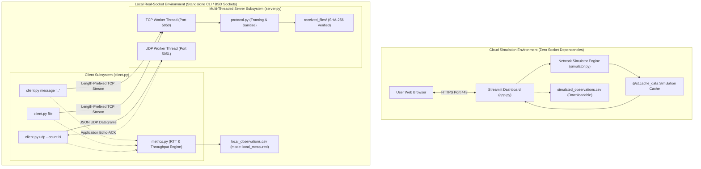
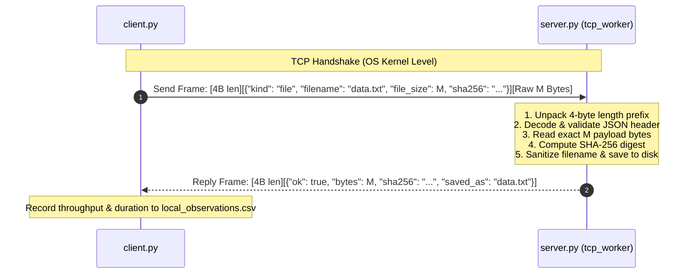
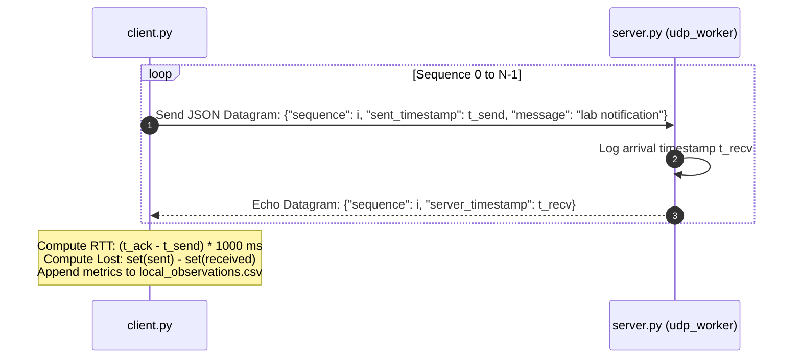

# TCP & UDP Transport Layer Communication Lab

[](https://www.python.org/)
[](https://streamlit.io/)
[](https://pandas.pydata.org/)
[](file:///d:/Case-Study/NS/tcp-udp-communication-lab/tests)
[](file:///d:/Case-Study/NS/tcp-udp-communication-lab/app.py)
[](file:///d:/Case-Study/NS/tcp-udp-communication-lab)

> An interactive dual-mode networking prototype bridging theoretical protocol analysis and real-world socket programming. Designed for Computer Networks & Security (Transport Layer curricula), featuring a cloud-safe Streamlit simulation suite and a robust, standalone Python BSD socket laboratory.

---

## Table of Contents

- [Overview & The Core Engineering Challenge](#overview--the-core-engineering-challenge)
- [System Architecture](#system-architecture)
- [Key Features](#key-features)
  - [Cloud Simulation Suite](#1-cloud-simulation-suite-streamlit)
  - [Local Real-Socket Laboratory](#2-local-real-socket-laboratory-local_lab)
- [Wire Protocol & Security Specification](#wire-protocol--security-specification)
  - [Length-Prefixed TCP Framing](#length-prefixed-tcp-framing)
  - [UDP Telemetry & Echo-ACK Protocol](#udp-telemetry--echo-ack-protocol)
  - [Defensive File Ingestion & Security Hardening](#defensive-file-ingestion--security-hardening)
- [Repository Structure](#repository-structure)
- [Developer Experience & Getting Started](#developer-experience--getting-started)
  - [Prerequisites](#prerequisites)
  - [Installation](#installation)
  - [Running the Interactive Dashboard](#running-the-interactive-dashboard)
  - [Running the Local BSD Socket Lab](#running-the-local-bsd-socket-lab)
  - [Two-Device Private LAN Execution](#two-device-private-lan-execution)
- [Automated Verification & Unit Testing](#automated-verification--unit-testing)
- [Experimental Observation Protocol](#experimental-observation-protocol)
- [Deployment Guide](#deployment-guide)
- [Technical Limitations & Boundary Conditions](#technical-limitations--boundary-conditions)
- [Project Metadata & Attribution](#project-metadata--attribution)

---

## Overview & The Core Engineering Challenge

Teaching and experimenting with Transport Layer protocols (TCP and UDP) presents a fundamental infrastructure challenge in modern web environments:

```
┌─────────────────────────────────────────────────────────────────────────────┐
│                       The Cloud Hosting Constraint                          │
│                                                                             │
│ Modern application platforms (such as Streamlit Community Cloud, Heroku,   │
│ and containerized PaaS) expose only standard HTTP/HTTPS endpoints (Port 443).│
│ They strictly block arbitrary inbound TCP and UDP listener sockets,         │
│ making live socket programming impossible inside standard cloud dashboards. │
└─────────────────────────────────────────────────────────────────────────────┘
```

Rather than sacrificing either interactive visual learning or low-level systems programming, this repository resolves the dilemma through an **intentional dual-mode architecture**:

1. **Cloud Simulation Mode ([app.py](file:///d:/Case-Study/NS/tcp-udp-communication-lab/app.py) & [simulator.py](file:///d:/Case-Study/NS/tcp-udp-communication-lab/simulator.py)):**
   - Completely decoupled from OS socket listeners.
   - Executes a deterministic, seeded network-condition simulator modeling propagation delay, serialization delay, transmission jitter, and packet loss.
   - Provides step-by-step visualizations of the TCP three-way handshake and sliding window flow control (`min(rwnd, cwnd, queued)`).
   - Generates downloadable CSV observation records with simulated telemetry.
2. **Local Real-Socket Laboratory ([local_lab/](file:///d:/Case-Study/NS/tcp-udp-communication-lab/local_lab)):**
   - Independent Python standard library implementation (`socket`, `struct`, `threading`, `hashlib`).
   - Runs on loopback (`127.0.0.1`) or across devices on a trusted private LAN.
   - Implements custom binary length-prefixed message framing over TCP with SHA-256 digest validation and traversal-resistant file ingestion.
   - Implements UDP datagram transmission with application-layer echo-ACK round-trip time (RTT) calculation and sequence tracking.
   - Appends measured operational logs directly to [local_observations.csv](file:///d:/Case-Study/NS/tcp-udp-communication-lab/local_lab/local_observations.csv).

---

## System Architecture

The following diagram illustrates how the cloud-facing educational interface and the local systems lab interact within the project ecosystem:



---

## Key Features

### 1. Cloud Simulation Suite ([app.py](file:///d:/Case-Study/NS/tcp-udp-communication-lab/app.py))

* **Interactive Three-Way Handshake Step-Through:**
  Step through `SYN`, `SYN-ACK`, and `ACK` phases with sequence number progression (`ISN x`, `ISN y`, `ack = x + 1`, `ack = y + 1`), reinforcing connection setup dynamics.
* **TCP vs UDP Comparative Matrix:**
  Comprehensive side-by-side analysis contrasting connection orientation, stream delivery, reliability semantics, flow/congestion handling, and port demultiplexing.
* **Flow & Congestion Control Dynamic Visualizer:**
  Interactive sliders for sender queue depth, Receiver Window (`rwnd`), and Congestion Window (`cwnd`). The interface calculates maximum in-flight segments via `min(rwnd, cwnd, queued)` and renders live buffer status with responsive color cues.
* **Configurable Seeded Network Impairment Engine:**
  Adjust packet volume (10–500), MTU payload bytes (64–1400 B), base one-way latency (0–1000 ms), packet loss probability (0–50%), and bandwidth caps (8–10,000 Kbps).
* **Real-Time Visual Analytics:**
  Generates per-packet latency trendlines (`st.line_chart`) and sequence-mapped loss bar charts (`st.bar_chart`).
* **Observation Record Export:**
  One-click CSV generation packaging test conditions and individual segment delivery statuses for academic lab reporting.

### 2. Local Real-Socket Laboratory ([local_lab/](file:///d:/Case-Study/NS/tcp-udp-communication-lab/local_lab))

* **TCP Reliable Message & File Transfer:**
  Establishes point-to-point connections over TCP port 5050 with explicit length framing and acknowledgment receipts.
* **SHA-256 Cryptographic Integrity:**
  Every file ingested over TCP is verified against its client-calculated SHA-256 digest before server-side disk persistence.
* **Directory Traversal Immunity:**
  Server-side sanitization strips path traversal vectors (`../`, `..\`, absolute paths), enforcing sanitized basenames inside a dedicated `received_files/` directory.
* **UDP Datagram Benchmarking:**
  Sends sequenced UDP packets over port 5051 with configurable batch counts and inter-packet delays.
* **Round-Trip Time (RTT) & Loss Detection:**
  Server reflects an application-level echo packet containing arrival timestamps, enabling the client to measure true RTT and detect asymmetric channel loss.
* **Unified Telemetry Logging:**
  Appends structured JSON and CSV records (`timestamp_utc`, `protocol`, `rtt_ms`, `throughput_bytes_s`, `duration_s`) to [local_observations.csv](file:///d:/Case-Study/NS/tcp-udp-communication-lab/local_lab/local_observations.csv).

---

## Wire Protocol & Security Specification

### Length-Prefixed TCP Framing

Because TCP is an unstructured, continuous byte stream without inherent message boundaries, higher-level applications must implement framing to avoid packet concatenation or fragmentation errors.

This laboratory implements a bounded, 3-part binary wire frame in [protocol.py](file:///d:/Case-Study/NS/tcp-udp-communication-lab/local_lab/protocol.py):

```
┌───────────────────────────┬───────────────────────────────────┬───────────────────────────┐
│  4 Bytes (Big-Endian !I)  │         Variable Length           │      Variable Length      │
│     HEADER_SIZE (N)       │       JSON METADATA HEADER        │       RAW PAYLOAD         │
│     (Max 16 KiB)          │   {"kind": "...", "size": M, ...} │   (Up to 10 MiB Cap)      │
└───────────────────────────┴───────────────────────────────────┴───────────────────────────┘
```

#### Frame Assembly Algorithm:
1. Serialize metadata header to UTF-8 encoded JSON (bounded to `MAX_HEADER_BYTES = 16,384`).
2. Prepend a 4-byte unsigned integer `struct.pack("!I", len(encoded_header))`.
3. Append raw binary payload (bounded to `DEFAULT_MAX_TRANSFER_BYTES = 10,485,760`).
4. On the receiving end, [recv_exact()](file:///d:/Case-Study/NS/tcp-udp-communication-lab/local_lab/protocol.py#L20) loops until precisely 4 bytes are received, unpacks the header length, reads exactly `N` header bytes, parses the JSON dictionary, and finally reads exactly `M` payload bytes.



### UDP Telemetry & Echo-ACK Protocol

UDP is connectionless and does not provide built-in acknowledgments or flow control. To measure network performance in [client.py](file:///d:/Case-Study/NS/tcp-udp-communication-lab/local_lab/client.py#L40) and [server.py](file:///d:/Case-Study/NS/tcp-udp-communication-lab/local_lab/server.py#L68), an application-layer echo loop is implemented:



> **Measurement Note:** In local UDP testing, missing echo acknowledgments can represent either forward-path packet loss or reverse-path acknowledgment loss. The measured duration captures round-trip latency (RTT), not strictly one-way propagation delay.

### Defensive File Ingestion & Security Hardening

The server script ([server.py](file:///d:/Case-Study/NS/tcp-udp-communication-lab/local_lab/server.py)) incorporates defensive engineering principles to prevent common network vulnerabilities:

1. **Path Traversal Prevention:**
   The `sanitize_filename()` function in [protocol.py](file:///d:/Case-Study/NS/tcp-udp-communication-lab/local_lab/protocol.py#L59) strictly rejects names containing forward slashes (`/`), backslashes (`\`), or parent directory tokens (`..`). Filenames are normalized against regex `[^A-Za-z0-9._-]` and limited to 128 characters.
2. **Transfer Caps & Resource Exhaustion Protection:**
   Transfers exceeding the 10 MiB limit (`DEFAULT_MAX_TRANSFER_BYTES`) are immediately aborted, preventing memory overflow or disk exhaustion.
3. **Collision Resistance:**
   If a file with the destination name already exists in `received_files/`, the server appends a millisecond timestamp suffix (`{stem}_{timestamp_ms}{suffix}`) to prevent silent overwrites.
4. **Digest Verification:**
   Before persisting incoming bytes to disk, the server recomputes `hashlib.sha256(payload).hexdigest()`. If the hash does not match the header claim, a `ProtocolError` is raised and the transaction is discarded.
5. **Loopback Safe-Default:**
   The server defaults strictly to `127.0.0.1`. Binding to public or external interfaces requires explicit command-line invocation (`--host`).

---

## Repository Structure

```
tcp-udp-communication-lab/
├── .streamlit/
│   └── config.toml             # Custom dark slate/cyan theme, headless server settings
├── local_lab/                  # Standalone BSD socket laboratory (Zero external dependencies)
│   ├── client.py               # CLI client (message, file, and udp benchmarking subcommands)
│   ├── config.example.json     # Sample parameter configuration file
│   ├── metrics.py              # Sequence analysis, throughput calculation, and CSV logger
│   ├── protocol.py             # Binary framing (4B prefix + JSON header), sanitization, SHA-256
│   └── server.py               # Concurrent multi-threaded TCP & UDP listener
├── tests/                      # Automated test suite (Standard library unittest)
│   ├── test_metrics.py         # Unit tests for throughput calculations & UDP sequence loss math
│   ├── test_protocol.py        # Framing round-trips, boundary caps, path traversal & mock sockets
│   └── test_simulator.py       # Seed determinism, zero-loss invariants, and parameter validation
├── .gitignore                  # Excludes venvs, caches, received files, and local CSV runs
├── app.py                      # Streamlit interactive learning dashboard (6 functional tabs)
├── DEPLOYMENT.md               # Production deployment runbook for Streamlit Community Cloud
├── README.md                   # Comprehensive project documentation & architecture guide
├── requirements.txt            # Minimal production dependencies (streamlit, pandas)
└── simulator.py                # Pure, seeded network-condition simulator engine
```

---

## Developer Experience & Getting Started

### Prerequisites

* **Python 3.10 or newer** (Tested and verified on Python 3.10 through Python 3.13).
* **Git** installed on your system.
* Standard CPython installation (no C compiler or external system libraries required).

---

### Installation

Clone the repository and set up a clean Python virtual environment:

#### Windows (PowerShell)

```powershell
# Clone the repository
git clone https://github.com/himanshu-jadhav108/ns-case-study-tcp-udp-communication-lab.git
cd ns-case-study-tcp-udp-communication-lab

# Create and activate virtual environment
python -m venv .venv
.\.venv\Scripts\Activate.ps1

# Upgrade pip and install minimal dependencies
python -m pip install --upgrade pip
pip install -r requirements.txt
```

#### macOS / Linux (Bash)

```bash
# Clone the repository
git clone https://github.com/himanshu-jadhav108/ns-case-study-tcp-udp-communication-lab.git
cd ns-case-study-tcp-udp-communication-lab

# Create and activate virtual environment
python3 -m venv .venv
source .venv/bin/activate

# Upgrade pip and install minimal dependencies
python3 -m pip install --upgrade pip
pip install -r requirements.txt
```

---

### Running the Interactive Dashboard

Launch the Streamlit web application:

```powershell
streamlit run app.py
```

After startup, your browser will open to `http://localhost:8501`.

```
  You can now view your Streamlit app in your browser.

  Local URL: http://localhost:8501
  Network URL: http://192.168.x.x:8501
```

Explore the 6 tabs: **Overview**, **TCP Handshake**, **TCP vs UDP**, **Flow & Congestion**, **Simulator**, and **Local Lab**.

---

### Running the Local BSD Socket Lab

The local socket lab operates completely independently of the Streamlit dashboard and relies strictly on Python's built-in standard library.

#### Terminal 1 — Launch the Local Server

```powershell
cd local_lab
python server.py
```

Expected server console output:
```json
TCP listening on 127.0.0.1:5050; UDP listening on 127.0.0.1:5051; files go to D:\...\local_lab\received_files
```

#### Terminal 2 — Execute Client Commands

Open a second terminal window (navigate to `local_lab/` or pass file paths accordingly):

##### 1. Send an arbitrary TCP text message:
```powershell
cd local_lab
python client.py message "Hello TCP Transport Layer"
```
*Output:*
```json
{
  "ok": true,
  "message": "message received",
  "bytes": 26,
  "duration_s": 0.0012,
  "throughput_bytes_s": 21666.67,
  "mode": "local_measured",
  "protocol": "TCP"
}
```

##### 2. Send a file over TCP (SHA-256 verified):
```powershell
python client.py file config.example.json
```
*Output:*
```json
{
  "ok": true,
  "message": "file received and verified",
  "bytes": 159,
  "sha256": "4b92b67...",
  "saved_as": "config.example.json",
  "duration_s": 0.0021,
  "throughput_bytes_s": 75714.28,
  "mode": "local_measured",
  "protocol": "TCP"
}
```
*Verification:* Inspect `local_lab/received_files/config.example.json` to verify saved contents.

##### 3. Transmit a sequenced UDP notification batch:
```powershell
python client.py udp --count 50 --interval 0.01
```
*Output:*
```json
{
  "sent": 50,
  "received": 50,
  "lost": 0,
  "unexpected": 0,
  "loss_percent": 0.0,
  "average_rtt_ms": 1.45,
  "duration_s": 0.528,
  "mode": "local_measured",
  "protocol": "UDP"
}
```

All client executions automatically record detailed performance rows to `local_lab/local_observations.csv`.

---

### Two-Device Private LAN Execution

To demonstrate network transport between two separate physical devices on the same local network:

> [!WARNING]
> Execute LAN mode **only on a trusted private network** (home or private lab Wi-Fi). Never bind to a public IP address or expose ports to the public internet.

1. **Determine Server LAN IP:**
   - Windows: Run `ipconfig` (e.g., `192.168.1.50`).
   - Linux/macOS: Run `ip addr` or `ifconfig`.
2. **Start Server on LAN Address:**
   ```powershell
   python server.py --host 192.168.1.50
   ```
3. **Configure Host Firewall:**
   Temporarily permit inbound traffic on TCP Port 5050 and UDP Port 5051.
4. **Execute Client from Second Device:**
   ```powershell
   python client.py --host 192.168.1.50 message "Hello from remote device"
   python client.py --host 192.168.1.50 udp --count 100 --interval 0.02
   ```
5. **Clean Up:**
   Terminate the server with `Ctrl+C` and remove temporary firewall exceptions after completing the experiment.

---

## Automated Verification & Unit Testing

The repository includes 9 unit tests verifying wire encoding, security boundaries, throughput math, and simulator determinism using Python's standard `unittest` framework:

```powershell
python -m unittest discover -s tests -v
```

### Verified Test Suite Breakdown:

| Test Module | Test Case | Target Capability Verified |
|---|---|---|
| [test_protocol.py](file:///d:/Case-Study/NS/tcp-udp-communication-lab/tests/test_protocol.py) | `test_frame_round_trip` | Validates framing and parsing of 4-byte prefixed JSON + payload across mock sockets |
| [test_protocol.py](file:///d:/Case-Study/NS/tcp-udp-communication-lab/tests/test_protocol.py) | `test_frame_size_limit` | Asserts `ProtocolError` is raised when inbound frames exceed memory allocation limits |
| [test_protocol.py](file:///d:/Case-Study/NS/tcp-udp-communication-lab/tests/test_protocol.py) | `test_filename_sanitization_and_traversal_rejection` | Rejects directory traversal payloads (`../secret`, `a\b.txt`, `..`, empty strings) |
| [test_protocol.py](file:///d:/Case-Study/NS/tcp-udp-communication-lab/tests/test_protocol.py) | `test_hash_verification` | Verifies SHA-256 computation against known reference digest |
| [test_protocol.py](file:///d:/Case-Study/NS/tcp-udp-communication-lab/tests/test_protocol.py) | `test_file_saved_under_receive_directory_and_acknowledged` | End-to-end socket transaction: receipt, hash validation, disk writing, and JSON ACK |
| [test_metrics.py](file:///d:/Case-Study/NS/tcp-udp-communication-lab/tests/test_metrics.py) | `test_udp_sequence_metrics` | Validates set-based sequence tracking (`lost`, `received`, `unexpected`, `loss_percent`) |
| [test_metrics.py](file:///d:/Case-Study/NS/tcp-udp-communication-lab/tests/test_metrics.py) | `test_throughput` | Verifies byte-rate math, zero-duration infinite speed handling, and negative guards |
| [test_simulator.py](file:///d:/Case-Study/NS/tcp-udp-communication-lab/tests/test_simulator.py) | `test_seeded_results_are_deterministic` | Proves identical pseudorandom seeds yield bit-for-bit identical simulated packet delays |
| [test_simulator.py](file:///d:/Case-Study/NS/tcp-udp-communication-lab/tests/test_simulator.py) | `test_zero_loss_and_invalid_inputs` | Verifies zero-loss invariants and strict boundary rejection (`packet_count=0`, `loss > 1.0`) |

---

## Experimental Observation Protocol

For structured academic coursework or self-paced networking research, use this standardized experimental workflow to compare ideal versus impaired channel performance:

### 4-Stage Experimental Matrix:

| Run | Experimental Condition | Simulation Parameters (Cloud) | Local Lab Equivalent | Primary Metric Observed |
|:---:|---|---|---|---|
| **1** | **Baseline Ideal Channel** | Delay: `0 ms`, Loss: `0%`, BW: `10,000 Kbps` | Localhost loopback (`127.0.0.1`), unthrottled | Minimum latency, peak throughput |
| **2** | **Propagation Delay Impairment** | Delay: `150 ms`, Loss: `0%`, BW: `10,000 Kbps` | Emulator delay injection (`tc/netem delay 150ms`) | Impact of RTT on transfer duration |
| **3** | **Bandwidth Bottleneck** | Delay: `10 ms`, Loss: `0%`, BW: `64 Kbps` | Rate limiting (`tc/netem rate 64kbit`) | Serialization delay, throughput ceiling |
| **4** | **Noisy / Lossy Channel** | Delay: `30 ms`, Loss: `15%`, BW: `1,000 Kbps` | Packet loss injection (`tc/netem loss 15%`) | UDP datagram loss vs TCP retransmission overhead |

### Telemetry Record Fields:

Both `local_observations.csv` and `simulated_observations.csv` export records adhering to this standardized schema:

| Field Name | Type | Description |
|---|---|---|
| `timestamp_utc` | ISO-8601 String | Coordinated Universal Time timestamp of the event |
| `mode` | String | Data provenance indicator: `simulated` or `local_measured` |
| `protocol` | String | Transport mechanism under test (`TCP`, `UDP`, or `UDP-like simulator`) |
| `event` | String | Action type (`message`, `file`, or `notification_batch`) |
| `sent` | Integer | Total segments dispatched |
| `received` | Integer | Total segments successfully acknowledged |
| `loss_count` | Integer | Undelivered or missing segments (`sent - received`) |
| `rtt_ms` | Float | Measured round-trip latency in milliseconds |
| `duration_s` | Float | Total elapsed transmission duration in seconds |
| `bytes` | Integer | Total payload volume transferred |
| `throughput_bytes_s` | Float | Measured or simulated data transfer rate (Bytes/sec) |
| `success` | Boolean | True if operation completed without loss or error |

---

## Deployment Guide

The web dashboard is fully configured for deployment on **Streamlit Community Cloud**.

Detailed instructions and deployment verification checklists are available in [DEPLOYMENT.md](file:///d:/Case-Study/NS/tcp-udp-communication-lab/DEPLOYMENT.md).

### Quick Deployment Checklist:

1. **Repository Setup:** Ensure your GitHub repository contains [app.py](file:///d:/Case-Study/NS/tcp-udp-communication-lab/app.py), [simulator.py](file:///d:/Case-Study/NS/tcp-udp-communication-lab/simulator.py), [requirements.txt](file:///d:/Case-Study/NS/tcp-udp-communication-lab/requirements.txt), [.streamlit/config.toml](file:///d:/Case-Study/NS/tcp-udp-communication-lab/.streamlit/config.toml), and the [local_lab/](file:///d:/Case-Study/NS/tcp-udp-communication-lab/local_lab) folder.
2. **Platform Configuration:**
   - Platform: [Streamlit Community Cloud](https://share.streamlit.io/)
   - Main file path: `app.py`
   - Python version: `3.10+` (Streamlit Cloud default 3.12 is fully supported)
3. **Environment Secrets:**
   - **None required.** The application is completely self-contained and does not call external APIs, authentication providers, or third-party databases.
4. **Cloud Guardrail:**
   - The application automatically renders a warning banner reminding cloud visitors that dashboard results are simulated due to cloud host port constraints.

---

## Technical Limitations & Boundary Conditions

To maintain technical accuracy, the following boundaries and design tradeoffs are documented:

* **Inbound Cloud Port Restriction:**
  As emphasized throughout, Streamlit Community Cloud isolates web applications and does not expose arbitrary inbound TCP or UDP ports. Real socket transfers must be run using `local_lab/` on a local machine.
* **Operating System TCP Congestion Algorithms:**
  In the local laboratory, TCP congestion control (Cubic, BBR, Reno) and flow control window advertisements are handled directly by the host operating system kernel. The Python code interacts with the socket API; it does not implement custom kernel-level TCP congestion algorithms.
* **Ephemeral Cloud Storage:**
  Files uploaded or generated in the Streamlit cloud environment exist only in container memory and ephemeral disk; they are cleared upon container restart.
* **CPU-Bound Simulation:**
  The simulation engine is implemented in pure Python and executes synchronously. Sliders cap simulation batches at 500 packets (up to 5,000 via direct API) to ensure instantaneous UI responsiveness on free-tier cloud containers.

---

## Project Metadata & Attribution

* **Curriculum Context:** Computer Networks & Security (NS) — Unit 3: Transport Layer (Pune college curriculum prototype).
* **Author / Maintainer:** Himanshu Jadhav (`himanshu-jadhav108` &lt;himanshujadhav40@gmail.com&gt;)
* **Core Technologies:** Python 3.10+, Streamlit, pandas, and standard library BSD sockets (`socket`, `struct`, `threading`, `hashlib`).
* **License:** No formal open-source license has been specified for this educational repository. All rights reserved by the original author unless specified otherwise.
